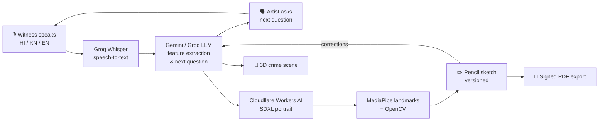

<div align="center">

# 🕵️ Nishaan

### AI Crime-Scene & Suspect-Sketch Generator


<br/><br/>

**🏆 Hackathon winning project at HackFest SVIT 2026 · Theme: AI Nexus**

*Official HackFest 2026 repository for team **lowcortisol (T1-05)**.*

</div>

---

## 📖 Overview

**Nishaan** turns a witness's spoken account into a **forensic suspect sketch** and a **3D crime-scene layout**.
A witness speaks naturally in **Hindi, Kannada or English**. An AI "sketch artist" interviews them, draws the face while they talk, and refines it one feature at a time ("make the jaw a bit wider", "he wore square glasses").

> ⚠️ **Investigative aid only. Not an identification.**

---

## ✨ Key Features

| | Feature | What it does |
|---|---|---|
| 🎙️ | **Multilingual voice interview** | Live speech-to-text in Hindi, Kannada and English. The AI artist asks direct follow-up questions and speaks them aloud. |
| ✏️ | **Live sketch drawing** | The face is redrawn as the witness talks, as a realistic pencil composite: outlines first, then graphite shading. |
| 🔁 | **Feature-by-feature refinement** | Natural-language corrections, sliders, overlays and inpainting, with every version saved. |
| 🧭 | **3D crime-scene builder** | Drag people and objects, describe changes by voice, and check line-of-sight. |
| 🔐 | **Secure evidence handling** | AES-256-GCM encrypted file store, JWT staff auth, role-based access, a tamper-evident audit chain and witness consent. |
| 📄 | **Exports & sign-off** | PDF exports, signed sessions, an evidentiary vault and an incident timeline. |
| 💻 | **Runs on a laptop** | No GPU, Docker, Redis or Postgres needed. A fully offline `mock` mode is available for demos. |

---

## 🧠 How It Works



---

## 🛠️ Tech Stack

<div align="center">


<br/>


</div>

| Layer | Technology |
|---|---|
| **Backend** | FastAPI, SQLAlchemy + Alembic, SQLite, WebSockets |
| **AI providers** | Google Gemini, Groq (Whisper `large-v3` + LLM), Cloudflare Workers AI (SDXL-lightning, SD 1.5 inpainting) |
| **Vision** | MediaPipe Face Landmarker (CPU), OpenCV |
| **Frontend** | React 18 + Vite, plain CSS ("evidence wall" design) |
| **Security** | AES-256-GCM file encryption, JWT, audit chain |
| **Quality** | 158 offline tests, 88% coverage on core and services, ruff, mypy |

---

## 🚀 Quick Start

### Backend

```bash
cd backend
python3 -m venv .venv && source .venv/bin/activate   # Windows: .\.venv\Scripts\Activate.ps1
pip install -e ".[dev]"
python scripts/download_assets.py
python scripts/make_placeholder_overlays.py
alembic upgrade head
python -m app.seed.seed          # prints demo users' passwords & witness token once
uvicorn app.main:app --reload    # http://localhost:8000/docs
```

### Frontend

```bash
cd frontend
npm install
npm run dev                      # http://localhost:5173
```

> 💡 Set `AI_MODE=mock` in `backend/.env` to run the whole flow **fully offline**, with no API keys.
> Cloud mode sends audio and prompts to Google, Groq and Cloudflare, so **use demo data only**.

Full setup, environment keys and API reference: [`backend/README.md`](backend/README.md) · [`backend/API.md`](backend/API.md) · [`frontend/README.md`](frontend/README.md)

---

## 📁 Project Structure

```
Nishaan/
├── backend/          # FastAPI app, providers, services, Alembic migrations, tests
├── frontend/         # React + Vite evidence-wall UI (staff desk & witness window)
└── frontend-test/    # Zero-dependency test console for every API endpoint
```

---

<div align="center">

**🏆 HackFest SVIT 2026 — Winner · Theme: AI Nexus**

Built by **Team lowcortisol (T1-05)**

</div>
